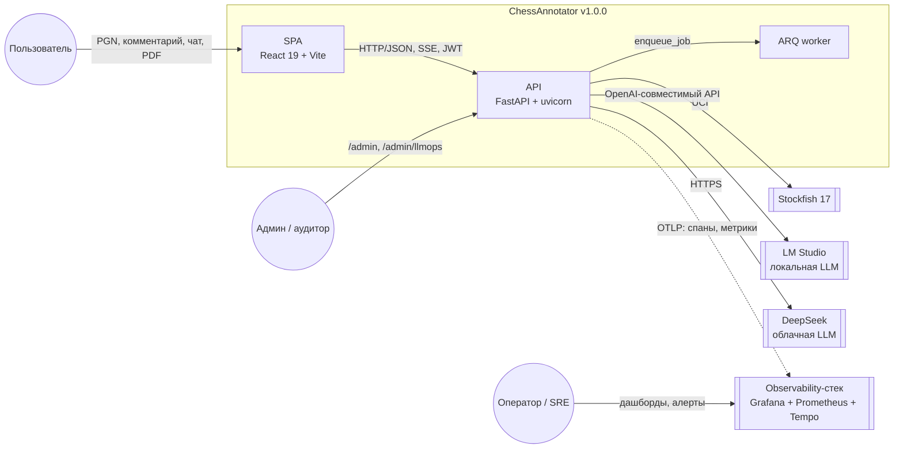
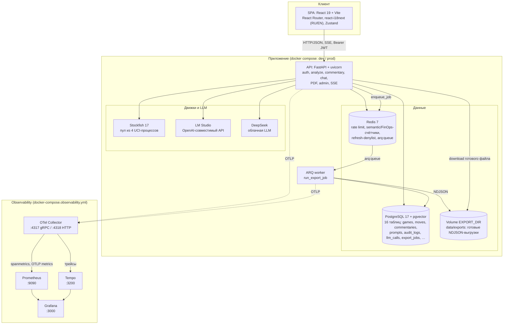

# ARCHITECTURE — ChessAnnotator v1.0.0

> Как устроена система сейчас. Источник истины по требованиям — `SPEC.md`;
> здесь — фактическая реализация v1.0.0 и границы.

## 1. Контекст и контейнеры (C4)

### 1.1. Level 1 — System Context

Кто пользуется системой и с какими внешними системами она общается.



Внешние зависимости: **Stockfish 17** (факты о позициях), **LM Studio**
(локальная LLM для `beginner`/`club` и эмбеддингов RAG), **DeepSeek**
(облачная LLM для `gm`), **observability-стек** (трейсы/метрики).
S3-совместимое хранилище в v1.0.0 не используется (Backlog).

### 1.2. Level 2 — Container



`EXPORT_DIR` — **общий volume** API и worker'а (`data/` в dev,
`prod_export_data` в prod): API отдаёт готовый файл, worker его создаёт.
Пара `Redis`/`EXPORT_DIR` связывает процессы; API сам выгрузку не
выполняет (KI-053).

## 2. Backend-модули

| Модуль | Ответственность |
| :--- | :--- |
| `app/ingestion/` | PGN/FEN → `ParsedGame`, ECO, фазы, повторы |
| `app/engine/` | async UCI-клиент Stockfish, пул, классификация, Policy, валидатор; `engine_cache` (T-108) |
| `app/export/` | PDF-экспорт комментария: fpdf2 + TTF-шрифт, подписи RU/EN (`language`), шапка/ходы/текст; `board.py` — SVG доски → PNG через cairosvg с graceful degradation (T-107/T-107b, KI-058) |
| `app/dataset/` | dataset-экспорт: `records.py` — общая выборка JSONL (фильтры/keyset/сборка записи), `jobs.py` — выгрузка `export_jobs` + recovery (KI-050/KI-053) |
| `app/worker.py` + `worker.py` | arq-воркер: `WorkerSettings`, задача `run_export_job(ctx, job_id)`, recovery при старте (KI-053) |
| `app/email/` | `EmailSender` Protocol + `MockEmailSender` (outbox/structlog), письма verify/reset (KI-041) |
| `app/auth/` | JWT access/refresh/action-tokens, Argon2id, cookie, denylist + global revocation (`revoked_before`), email-verification dependency (KI-041) |
| `app/motifs/` | эвристики мотивов (слабые поля, линии, вилки, мат и т.д.) |
| `app/llm/` | OpenAI-совместимый клиент, фабрика по уровню, пакет фактов, прогрев |
| `app/prompts/` | системные промпты `beginner`/`club`/`gm` + `chat`: `.txt` — seed/fallback (ru), `*_en.txt`/`chat_en.txt` — английские файлы, таблица `prompts` — источник истины для ru, in-memory кэш, `resolve_language` |
| `app/i18n.py` | локализация `detail` ошибок API по `Accept-Language` (KI-058, итерация 35) |
| `app/finops.py` | дневные счётчики токенов в Redis, `TokenBudgetMiddleware` (429), `cost_usd` |
| `app/security/` | prompt-injection guardrails: нормализация, эвристики, `422 prompt_injection` |
| `app/audit.py` | append-only аудит, hash-chain, advisory-lock, верификация |
| `app/cache/` | semantic cache: exact FEN-ключ, vector-поиск, TTL |
| `app/web.py` | SPA static + fallback на `index.html` для `/history`, `/analysis/:id` |
| `app/commentary/` | сборка анализа из БД, генерация, retry, кэш, правка |
| `app/chat/` | вопрос → контекст → LLM → валидатор → ответ |
| `app/rag/` | ingest аннотированных партий, эмбеддинги, retrieval, контекст |
| `app/admin.py` | starlette-admin: JWT/legacy-аутентификация, RBAC, read-only views (включая `export_jobs` с фильтром по статусу), аудит и экспорт |
| `app/llmops_dashboard.py` | LLMOps-дашборд `/admin/llmops`: p50/p95/p99, error rate, tokens/cost, cache hit rate, топ-5 пользователей |
| `app/observability.py` | OTel: TracerProvider/MeterProvider, OTLP-экспорт спанов и метрик `llm.*`; `app/tracing.py` — W3C trace-context, HTTP-спан с `http.route`/статусом для spanmetrics |
| `deploy/` | конфиги observability-стека: `otel-collector`, `tempo`, `prometheus`, `grafana` (datasources + дашборд) |
| `app/api/v1/` | `analyze`, `games`, `users`, `commentary`, `chat`, `ingest`, `health`, `auth`, `admin_exports` |
| `app/db/` | SQLAlchemy-модели, сессии, Alembic-миграции |

## 3. Потоки

### 3.1. Анализ партии

```text
POST /v1/analyze
  → parse_pgn (python-chess: легальность, ECO, фазы)
  → EnginePool.analyze_game_moves (MultiPV по уровню)
     ↳ EngineCache: попадание по (fen_hash, engine_version, depth, multipv)
       → без запуска поиска; промах → Stockfish → best-effort store
  → detect_motifs + classify_move + choose_recommended_move
  → INSERT games/moves/motifs
  → JSON: analysis_id, initial_fen, moves[] с fen/оценкой/мотивами
```

### 3.2. Комментарий

```text
POST /v1/commentary {analysis_id, level, style?, language?}
  → language = request → Accept-Language → DEFAULT_LANGUAGE (T-106)
  → load_game + load_analyses (moves/motifs/multipv)
  → build_fact_package (метаданные, ходы, ключевые моменты)
  → [+ RAG-контекст для gm]
  → load_system_prompt(level, language)  # ru = БД/файл, en = *_en.txt
  → get_llm_client(level).complete
  → extract_moves_from_text + validate_moves
  → retry (до 2) при нелегальных ходах (подсказка на языке комментария)
  → INSERT commentaries
  → JSON: text, tokens_used, validated, model, attempts
```

### 3.3. Чат

```text
POST /v1/chat {analysis_id, question, history?, language?}
  → language = request → Accept-Language → DEFAULT_LANGUAGE (итерация 35)
  → те же load_game/load_analyses + build_fact_package
  → CHAT_SYSTEM_PROMPT (ru | en — app/prompts/chat_en.txt) + <вопрос>
  → LLM → validator (mainline + PV positions) → retry
  → JSON: reply, tokens_used
```

### 3.4. Правка

```text
PATCH /v1/commentaries/{id}
  → SELECT ... (original_text)
  → UPDATE text, human_edited=true
  → INSERT edits(original_text, edited_text)
  → JSON: комментарий + edit_id
```

## 4. API v1.0.0

Все эндпоинты, кроме `/auth/*`, `/v1/health` и `/docs`, требуют
`Authorization: Bearer <access>`.

| Метод | Путь | Назначение |
| :--- | :--- | :--- |
| POST | `/auth/register` | регистрация (`is_verified=false`) |
| POST | `/auth/login` | access в JSON + refresh в HttpOnly-cookie |
| POST | `/auth/refresh` | ротация пары по refresh-cookie |
| POST | `/auth/logout` | отзыв `jti` + очистка cookie |
| POST | `/auth/logout-all` | `revoked_before` — отзыв всех refresh |
| GET | `/auth/verify-email` | подтверждение email по токену |
| POST | `/auth/forgot-password` | 202 без enumeration |
| POST | `/auth/reset-password` | Argon2id + отзыв старых refresh |
| GET | `/auth/me` | профиль текущего пользователя |
| POST | `/v1/analyze` | PGN + level → анализ, `analysis_id`, `analysis_level` |
| GET | `/v1/games` | список партий (только свои; admin — все) |
| GET | `/v1/games/{id}` | сохранённый анализ + `commentaries` без Stockfish |
| GET | `/v1/users/me/usage` | FinOps: Redis + `usage_daily` |
| POST | `/v1/commentary` | `analysis_id` + level + `language` → комментарий |
| POST | `/v1/commentary/stream` | SSE: `meta`/`delta`/`done`/`error` |
| PATCH | `/v1/commentaries/{id}` | ручная правка + `edits` |
| GET | `/v1/commentaries/{id}/export/pdf` | PDF + диаграммы доски (T-107/T-107b); `language=ru\|en` (итерация 35) |
| POST | `/v1/chat` | вопрос по `analysis_id` (+ `language`, итерация 35) |
| POST | `/v1/chat/stream` | SSE-ответ чата |
| POST | `/v1/ingest` | PGN → `annotated_games` (`X-Admin-Token`) |
| GET | `/v1/admin/exports/edits.jsonl` | streaming NDJSON датасета (admin/auditor) |
| POST | `/v1/admin/exports/jobs` | фоновая выгрузка (202, admin/legacy) |
| GET | `/v1/admin/exports/jobs/{id}` | статус джобы |
| GET | `/v1/admin/exports/jobs/{id}/download` | готовый JSONL (409/410) |
| GET | `/v1/health` | БД/Redis/Stockfish/LLM |
| GET | `/docs` | OpenAPI |
| GET | `/admin`, `/admin/llmops` | starlette-admin: read-only views, `export_jobs` (фильтр по статусу), промпты, LLMOps-дашборд |

Ошибки — `{"detail", "code"}`; коды: 400/403/404/422/429/500/502/503/504.
`detail` доменных `AppError` локализуется по `Accept-Language`
(`app/i18n.py`): при запросе `en` для известного `code` возвращается
английский текст, иначе — исходное сообщение; `code` и HTTP-статус не
меняются (итерация 35).

## 5. База данных

16 таблиц: `users`, `games`, `moves`, `motifs`, `annotated_games`,
`retrieval_cache`, `commentaries`, `edits`, `prompts`, `audit_logs`,
`semantic_cache`, `llm_evaluations`, `llm_calls`, `usage_daily`,
`engine_cache`, `export_jobs`. Основное:

- `moves` — SAN/FEN/eval/best/delta/class/multipv;
- `motifs` — тип, описание, важность, FK на ход;
- `games` — PGN, ECO, фазы, `analysis_level`, `analysis_time_ms`;
- `annotated_games` — RAG: PGN, метаданные, аннотация, `vector(768)`
  (LM Studio nomic-embed);
- `commentaries` — текст, модель, токены, `validated`, `human_edited`;
- `edits` — пары «оригинал → правка» (датасет);
- `export_jobs` — фоновые выгрузки: статус, снимок фильтров, путь к
  JSONL в `EXPORT_DIR`, размер/sha256, число строк (KI-050);
- `users.is_verified` — подтверждение email (KI-041).

Миграция — `dcf1da1421cd` (head); `alembic check` без дрейфа.

## 5.1. Observability

```text
app (OTel SDK) --OTLP/HTTP--> otel-collector --gRPC--> tempo (трейсы)
                                   |--spanmetrics--> :8890 --\
                                   |--OTLP metrics--> :8889 --> prometheus --> grafana
```

Стек поднимается `docker-compose.observability.yml` (Grafana :3000,
Prometheus :9090, Tempo :3200, collector :4317/:4318). Дашборд
`deploy/grafana/dashboards/chessannotator-observability.json` провижинится
автоматически: latency p95/p99 `/v1/commentary` и `/v1/analyze`, error
rate 5xx, стоимость и токены LLM. HTTP-спан `http_request` несёт
`http.route` (полный, с префиксом) и `http.response.status_code`; при
`OTEL_ENABLED=true` спаны и метрики уходят в коллектор, при `false` —
no-op. Alert rules (T-113) — `deploy/grafana/provisioning/alerting/
rules.yaml`: `HighErrorRate`, `HighLatency`, `LLMBudgetExceeded`;
Grafana unified alerting, отдельный Alertmanager не требуется.

## 5.2. Auth lifecycle (KI-041, KI-055)

JWT подписывается **PyJWT** (HS256): python-jose убран в T-110 из-за
PYSEC-2026-4298, а его транзитивный python-ecdsa — PYSEC-2026-1325.
Формат токенов не изменился, старые HS256-токены остаются валидными.

```text
register → users.is_verified=false → MockEmailSender (verify JWT 24h)
         → frontend /verify-email?token → GET /auth/verify-email
         → is_verified=true
analyze/commentary → get_current_verified_user
         → 403 email_not_verified (admin/auditor bypass)
forgot-password → frontend /forgot-password → 202 (no enumeration)
         → reset JWT 30m → /reset-password?token
         → POST /auth/reset-password
         → Argon2id + revoked_before:<user_id> (одноразовый токен)
logout-all → revoked_before:<user_id> (Unix-ms)
refresh → проверка jti-denylist + issued_at (iat_ms) > revoked_before
```

Неверифицированный пользователь может войти и читать `/auth/me`, но UI
показывает экран «Подтвердите email» (`AuthGate`), а генерация закрыта.
Ссылки в письмах строятся от `APP_BASE_URL` (SPA), а не от API:
`/verify-email` и `/reset-password`. `MockEmailSender` пишет ссылку в
structlog; SMTP — KI-056. Global revocation fail-open при недоступном
Redis (как denylist).

## 5.3. Фоновые задачи и retention (KI-053, KI-054)

```text
API POST /v1/admin/exports/jobs
  → export_jobs(queued) → Redis arq:queue (enqueue_job)
  → arq worker: run_export_job → JSONL в EXPORT_DIR → done/failed
API/worker startup → recover_stale_export_jobs: running >15 мин → failed
cron → scripts/prune_export_jobs.py: created_at < cutoff
     → удалить файл внутри EXPORT_DIR → DELETE export_jobs
```

Docker-сервис `worker` (`arq worker.WorkerSettings`) в dev/prod compose,
общий volume `data`/`prod_export_data`; API-процесс не выполняет выгрузку.
Если Redis недоступен — 503 `export_queue_unavailable`, джоба `failed`.
Retention по умолчанию 7 дней (`EXPORT_RETENTION_DAYS`); файлы вне
`EXPORT_DIR` не удаляются, signed URL — KI-057. В `/admin` есть read-only
view `export_jobs` с фильтром по статусу (итерация 35).

## 5.4. Локализация (RU/EN)

```text
язык = поле запроса (language) → заголовок Accept-Language → DEFAULT_LANGUAGE
       (app/prompts/resolve_language)
```

- **Промпты.** Русские промпты — источник истины в таблице `prompts`
  (seed из `app/prompts/*.txt`, редактируются в админке, версия,
  hot-reload). Английские — **файлы** `app/prompts/{beginner,club,gm}_en.txt`
  и `app/prompts/chat_en.txt`; в админке не редактируются, в БД не
  хранятся (остаток закрытого KI-058).
- **Область локализации (v1.0.0):** UI (`react-i18next`), комментарий,
  чат (sync + SSE), PDF-подписи и `detail` доменных ошибок API.
- **Что остаётся русским:** «пакет фактов» (оценки, мотивы, SAN-варианты,
  метаданные партии) — LLM переводит его в текст на выбранном языке;
  вычитки носителем не было (KI-058 residuals).
- **PDF.** `language` — query-параметр `GET .../export/pdf`; от него
  зависят заголовки и подписи, но не PGN/SAN.

## 6. Frontend

- React 19 + TypeScript + Vite + React Router; `react-chessboard`
  5.12.1 для доски, `chess.js` (`history({verbose:true})`) для FEN из
  PGN, `react-i18next` (RU/EN), Zustand с persist в `sessionStorage`.
- Маршруты: `/` (PGN + анализ), `/history` (последние 20; для
  неподтверждённых — плейсхолдер «Подтвердите email, чтобы увидеть
  историю», итерация 35), `/analysis/:id` (загрузка сохранённого
  анализа), публичные `/verify-email`, `/forgot-password`,
  `/reset-password` (KI-055). `AnalysisWorkspace` общий для главной и
  карточки.
- Auth-UX: `AuthGate` при `is_verified=false` показывает экран
  «Подтвердите email»; в шапке — `ProfileMenu` с «Выйти» и «Выйти со всех
  устройств» (`POST /auth/logout-all`).
- Комментарий: inline-редактор + `PATCH`; кнопка «Скачать PDF»
  (`GET .../export/pdf`, JWT-refresh, передаёт `language` из i18n).
- Чат: `chatStore` (Zustand, `sessionStorage`), история уходит в
  `/v1/chat` и `/v1/chat/stream` как `history`; передаётся `language`.
- API-клиент — `web/src/api.ts`; SSE читается через `ReadableStream`,
  текст печатается постепенно. Ошибки API показываются по `code`, текст —
  локализованный `detail` из ответа.
- Production: `pnpm build` → `web/dist` → `SPAStaticFiles("/")` в FastAPI
  (index.html для `/history` и `/analysis/:id`).
- UX: skeleton-лоадеры, Error Boundary, mobile 1280/820/640/480,
  usage-badge.
- Тесты — Vitest: 9 файлов, 81 тест (FEN/chess.js, board,
  форматирование, SSE-парсер, auth-store/API/flow, PDF-API, eval, PGN);
  E2E — Playwright, mocked-режим 32 прогона (16 сценариев ×
  chromium/mobile).

## 7. Развёртывание

- `Dockerfile`: multi-stage — Node собирает SPA, Python-образ получает
  `web/dist`, Stockfish, `libcairo2`/`fonts-dejavu-core`, зависимости и
  запускается non-root.
- `docker-compose.yml` (dev): `postgres`, `redis`, `worker`; опциональные
  профили `engine` (Stockfish-over-TCP) и `llm-local` (vLLM).
- `docker-compose.prod.yml`: `app` + `worker` + `postgres` + `redis`;
  БД и Redis опубликованы **только на 127.0.0.1**, API — на loopback за
  reverse-proxy; общий volume `prod_export_data`; healthcheck
  `/v1/health`.
- `app` при старте выполняет `alembic upgrade head`, затем uvicorn;
  число воркеров — `WORKERS`.
- `docker-compose.observability.yml`: `otel-collector`, `tempo`,
  `prometheus`, `grafana` (отдельный проект `chessannotator-observability`).
- GHCR: job `publish-docker` в CI по тегу `v*` публикует
  `ghcr.io/iilmchat/ai-chess-annotator:{vX.Y.Z,X.Y.Z,latest}`.

## 8. Безопасность и ограничения v1.0.0

- JWT + роли `user/admin/auditor`, refresh в HttpOnly-cookie, Redis-denylist;
  `/v1/ingest` дополнительно защищён `X-Admin-Token` (constant-time).
- CORS — только явные origin-ы (`*` запрещён при `allow_credentials=True`,
  T-110); в prod секреты-плейсхолдеры отвергаются на старте.
- Rate limit 10/мин на IP, fail-open при недоступном Redis (KI-015).
- Валидатор проверяет легальность SAN, не семантику (KI-023).
- RAG-эмбеддинги — LM Studio 768 (L2); hash — fallback тестов.
- SSE-стриминг реализован; история чата хранится только на клиенте
  (`sessionStorage`) и уходит в запрос — серверной истории нет.
- Слепой тест уровней (T-024) не проводился; генератор материалов
  `scripts/generate_blind_test.py` готов (итерация 35).
- Локализация: русский «пакет фактов», en-промпты файлами, без вычитки
  носителем — остатки закрытого KI-058.
- LLM-качество ниже целевого 7/10 (KI-030 Open); обучение LoRA не
  выполнялось (нет GPU).

## 9. Что дальше

v1.0.0 — стабильный релиз: админка, prompt registry, OTel/LLMOps,
FinOps, semantic cache, guardrails, audit, фоновые выгрузки и
observability-стек закрыты. Дальше: живой слепой тест (T-024), вычитка
EN-промптов носителем, качество LLM/LoRA (KI-030), signed URL (KI-057),
multi-tenant и SSO (Backlog T-111…T-119).
